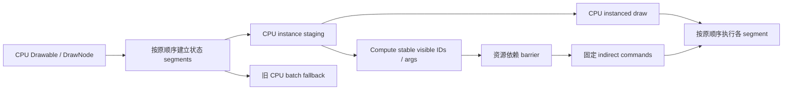

# g0v0!framework GPU-driven 渲染管线研究

研究日期：2026-10-26。范围：现有 Drawable/DrawNode、批处理、静态网格、Veldrid 后端能力与官方 API 资料的只读审查。本文只提出设计和验证方案；没有修改生产代码，没有运行新的 GPU 验证、应用或 benchmark。此前 bindless 探测日志只报告 RTX 5060 Laptop GPU 的 descriptor-indexing 物理设备能力，不代表本轮验证过 compute、indirect、barrier 或 GPU-driven 渲染。

## 结论与推荐顺序

当前 framework 仍由 CPU 构建 Drawable/DrawNode 状态、执行现有 CPU 几何裁剪并按顺序提交批次。Deferred 是延后记录和回放 CPU 创建的绘制事件，并不等于 GPU 驱动场景。底层 Veldrid 已有 compute dispatch 与若干后端的 indirect draw 调用，但 framework 尚无将场景对象整理成 GPU 实例、稳定压缩可见对象、生成命令并维护对应同步的完整编排层。

建议逐步推进：

1. **保留 CPU 有序 segment。** 明确状态分段和原始提交顺序，先以录制数据判断是否存在值得处理的CPU瓶颈。
2. **对窄范围对象试做 CPU instancing。** 首选大量相同内置 shader、几何简单、材质状态兼容的 sprites；不改变 Drawable API 或排序。
3. **只在测量有收益时加入局部 GPU culling。** 每个 segment 用稳定 scan/compact 得到 visible IDs，再以固定 segment buffer slice 和 indirect command 绘制；保留 CPU fallback。
4. **之后再考虑 persistent scene。** 这要求常驻实体数据、增量更新、资源生命周期和跨帧同步，只有长期静态大场景或 GPU 模拟等目标才能摊平成本。

GPU-driven 不要求先有 bindless 或 multi-draw indirect。对单个兼容 segment，CPU 可固定提交一条 instanced indirect command，GPU 更新其 `InstanceCount`；这已经避免 CPU 回读 GPU 可见数量。普通 indirect 参数缓冲与 GPU 生成 draw count 是两件事：若 CPU 仍提交固定 `drawCount`，不可见的 command 可令 `InstanceCount=0`；只有 indirect-count API 才能由 GPU 决定执行多少条 command。

## 现有行为与正确性边界

`DrawNode.ApplyState()` 把 Drawable 状态复制到供渲染使用的节点。CPU 在 opaque-interior pass 中分配 DrawNode depth；`DepthValue` 可能耗尽可递增的 depth 值，现有逻辑据此限制后续 opaque-interior 绘制。`CompositeDrawable.DrawNode` 反向遍历并绘制 opaque interior、同时分配 depth；普通内容则正向绘制并保留常规混合顺序。首版应沿用 CPU 快照中的 depth 与 pass 顺序。GPU 剔除只判断对象是否参与原定 pass，不得把剩余对象随意重排或重新编号深度。普通透明绘制的提交顺序必须保留。

mask、scissor、blend、depth/stencil、shader、framebuffer、viewport/projection 和 sampler/wrap 等仍是状态边界。mask/scissor 的变化需切换 segment 或按旧路径绘制；不能把不同 mask 的几何合并成一个普通实例 draw。CPU 已有保守几何裁剪或 draw-node 剔除，重复把同样工作搬到 GPU 可能只增加扫描成本。

零 alpha 不是足够的剔除条件：mask shader 可能仍输出边框，blend/depth 状态也可能造成副作用。首个 GPU culling 版本宜做保守的屏幕空间包围盒测试，并对整个 segment 保持原顺序。先不做 HiZ/透明遮挡剔除：透明对象互相覆盖时不可仅凭深度忽略后方颜色贡献。

## 建议的分层数据流

每个 segment 保存完整的兼容状态键及原始顺序范围。实例记录只放逐对象变化的数据：简化 sprite 可用位置/尺寸、统一颜色、UV rect、texture slot、blend range、depth 和少数 flags；顶点着色器按 vertex ID 展开 quad。独立四角颜色、任意四角位置/UV、仿射变换或自定义顶点布局都会增加记录尺寸，复杂对象应走旧路径。

现有 `TexturedVertex2D` 是 15 个 float、60B/vertex，即 240B/quad，多个字段在四个顶点重复。简化 sprite 的实例可接近 64B，理论上比四顶点记录更紧凑；但通用实例可能达到或超过 80–128B。GL/Veldrid 当前已有 dirty/equality 上传复用，故不能把 240N→64N 宣称为每帧必然传输量下降。只有测得 CPU 顶点构造、写入或上传字节确有下降，才能将其算作收益。

首版实例路径建议只支持内置 textured shader 与简单 RGBA sprite。R8 字体 alpha shader、视频多平面、custom shader/custom vertex、static mesh、特殊 wrap 或 sampler 组合保留旧路径。纹理槽身份应包括实际 native texture/view 与 sampler 语义；atlas region 仍携带原 UV。白像素快捷绘制要指向实际包含白像素的 atlas page。是否使用 descriptor array/bindless 是独立的资源选择，不应成为 instancing 或 GPU culling 的前提。

### SpriteText 与 Path 的迁移边界

- `Graphics/Sprites/SpriteText.DrawNode.cs:85-141` 按 parts 顺序遍历 glyph；每个 glyph 检查纹理可用性/绑定，按需要先提交 shadow 再提交 foreground，并准备完整四顶点。可将满足同一 shader/状态条件的 glyph 表示为紧凑实例，但必须保持 part 顺序、shadow/foreground 的交错顺序、atlas UV/padding 和 pending upload 语义。字体 R8 与普通 RGBA shader 不同，首版不能把所有字体 glyph 混进普通 sprite segment。
- `Graphics/Lines/Path.cs:43-58,259-313` 中的顶点可整体替换、追加或替换单点，导致 bounds/segment cache 失效；`Graphics/Lines/Path.DrawNode.cs:53-119` 按 segment 版本、radius 和 range 失效后重新生成 path quad 顶点。普通路径现在用 chunk screen-space bounds 在 CPU 上剔除后提交动态顶点（`:167-183`）。将 path 变为 GPU instance 需要把段连接/cap/join 规则、局部坐标、矩阵和动态更新一并迁移，不能只把已有顶点换成 indirect draw。
- `Path.DrawNode.cs:186-232` 的 `DrawRange` 特例先以 `StaticQuadMesh<PathVertex>` 绘制稳定内段，再动态绘制 range 两端；`Graphics/Rendering/StaticQuadMesh.cs:18-73` 创建后不可变，绘制只支持完整 quad 范围。因此它是“静态核心 + 动态边缘”的可复用模式示例，不是可覆写的 GPU instance ring，也不提供 indirect/compute 接口。若range/路径几何变化，现有路径会废弃并重建静态 mesh。

## 稳定压缩与命令生成

透明序列不可用无序 atomic append：不同工作组的追加顺序不确定，可能改变 alpha blending 结果。安全做法是对原输入顺序计算可见 flag，执行 exclusive prefix scan，再将可见实例写入 `prefix[i]` 对应位置。稳定压缩只删除对象，不重排保留对象。按 segment 独立处理，不跨不同 shader/mask/scissor/render target 合并。Vulkan 常规 color attachment 的 fixed-function blending 按 primitive/rasterization order 对颜色产生可观察结果，因此稳定 visible IDs + 每 instance 固定 quad 可保留透明合成次序；GPU shader 执行可并行，不需要将 shader 串行化。shader storage/image 写入或 atomic side effect 不享有同一渲染顺序保证，不能把此结论推广到有副作用的自定义 shader。跨 API 仍须按各自规范和测试验证。

MVP 可先给每个 segment 预留固定的可见 ID slice 和一条固定 indirect command。Compute 写入 compact IDs 及 `InstanceCount`；空 segment 写零实例。Graphics 按 CPU 已知的 segment 原始顺序提交所有 command，因而不需要 GPU count 回读或 indirect-count API。显式传 `segmentBase` 给 shader，并让 command 的 `FirstInstance=0`，可以避免依赖跨 API base-instance 行为；例如 GL `gl_InstanceID` 不包含 base instance，而 Vulkan `gl_InstanceIndex` 包含 `firstInstance`。后续只有 command 数量本身造成 CPU 负担时，才考虑按能力启用 GPU indirect count；不支持则保留固定数量命令路径。

一个 segment 的 compact dispatch 放在对应 render pass 绘制之前集中执行，不应每个 glyph 或 drawable 各 dispatch 一次。Vulkan 上 compute storage 写入之后，indirect command 读取与 vertex/shader storage 读取都需要相应的 pipeline barrier。仓库已有的 `CopyBuffer` transfer-write barrier 只覆盖 transfer 写入场景，不能替代 compute-write 到 indirect/storage-read 的依赖。现有 Vulkan `DrawIndexedIndirect` 实现存在，但尚未看到 framework 自动为任意 compute 输出补齐此类同步。OpenGL command executor 的 `glMemoryBarrier(AllBarrierBits)` 是保守同步方式；也需确认具体路径和成本。

## Veldrid 能力核实与限制

| 后端/层 | 当前可核实能力 | 尚缺或需留意 |
|---|---|---|
| Vulkan device feature | `VkGraphicsDevice.cs` 约 999 行将 `deviceFeatures` 设为 `physicalDeviceFeatures`，约 1098 行把它传入 `pEnabledFeatures`。因此受支持的 Vulkan 1.0 basic `multiDrawIndirect` feature 会被启用；不能说该 feature 未启用。 | 上层未暴露/校验 `maxDrawIndirectCount` 等能力限额；framework 没有 GPU-driven 编排。 |
| Vulkan commands | `VkCommandList.cs` 约 529–543 行调用 `vkCmdDrawIndirect` / `vkCmdDrawIndexedIndirect`。Indexed-indirect 命令本身是 Vulkan 1.0 核心。 | 当前未见 `vkCmdDrawIndexedIndirectCount` 路径。Indirect-count 是 Vulkan 1.2 核心或相应扩展；不要把普通 indirect 的固定 count 当 GPU count。Compute 写入后同步需单独设计。 |
| D3D11 | Veldrid 记录多次 `DrawInstancedIndirect` / `DrawIndexedInstancedIndirect`，args 仍由 GPU 从 buffer 读取，不需 CPU 回读参数。 | 调用次数/count 由 CPU 记录；不能据此推断 GPU 自动生成 draw count。 |
| Metal | 当前 MTL command list 有 indirect draw API；Veldrid 目前走 CPU 记录多个 indirect 调用、GPU 读参数的模式。 | 当前不是 Metal Indirect Command Buffer（ICB）GPU 编码实现。 |
| OpenGL | command executor 提供 dispatch、indirect draw；有 MDI 扩展时用 `glMultiDraw*Indirect`，否则 CPU 循环多个 `glDraw*Indirect`。dispatch 后有 `AllBarrierBits` 的保守内存屏障调用。 | GLES 3.1 提供 compute/indirect 能力不保证 MDI 或 base-instance 能力；逐设备核对扩展与 shader 索引语义。需把同步限定到对应资源/使用场景，并验证成本。 |

Framework 层还有几项具体边界：`IRenderer` 没有 compute/indirect 编排接口；现有 `VeldridShaderStorageBufferObject<T>` 只创建 `StructuredBufferReadOnly | Dynamic` 数据缓冲（不支持 structured buffer 时回退到 `UniformBuffer | Dynamic`），不是 GPU writable instance/command pipeline。`GraphicsPipeline.DrawVertices()` 当前调用 `DrawIndexed(..., instanceCount: 1, ...)`，没有 instanced/indirect draw 编排。

Khronos Multi-Draw Indirect sample 可用于理解 GPU 生成命令和纹理索引的设计，但 sample 的描述存在对功能版本的简化；应以 Vulkan API/spec 对照：`vkCmdDrawIndexedIndirect` 是核心 1.0，而 `vkCmdDrawIndexedIndirectCount` 是核心 1.2/扩展。D3D12 ExecuteIndirect 示例可说明另一种后端的 GPU 命令生成，但不是 g0v0 当前 D3D11 后端能力证据。

## 成本模型：何时 CPU 仍更便宜

成本要分开记账，不能把 CPU/GPU 各自的局部工作简单相加或直接相减。先定义 `N` 为**当前 CPU cull 后、进入待绘制 segment 的候选数**，`V` 为新增 GPU cull 后的可见数，`S` 为有序状态 segment 数。若现有 CPU culling 已经做过剔除，只有剩余候选交给 GPU，不能把被 CPU 丢弃的对象重复算入 `N`。对照矩阵分别记录：

| 维度 | 现有 CPU batch | GPU-driven 新增/节省 |
|---|---|---|
| CPU render thread | 当前状态收集、可见对象遍历、顶点准备/写入、draw/segment API 调用 | CPU instancing/vertex-shader 展开可省四顶点 CPU 构造，这是 instancing 收益，不是 culling 收益。CPU-staging MVP 仍需 gather、stage 并上传全部 N 个候选实例；在没有 GPU 可见结果回读前，GPU culling 不能有条件省掉被剔除实例的本帧 CPU 准备或上传。新增 segment/command 记录、dispatch、资源管理和同步安排；固定 segment command 仍由 CPU 记录。 |
| GPU graphics | 当前可见对象的 vertex/instance、raster 和 fragment 工作 | culling 后被移除对象可省去对应后续 graphics 工作；新增 compute scan/scatter、indirect 读取、barrier 依赖与缓冲访问。 |
| 内存/生命周期 | 现有 vertex batch 与后端 buffer 轮换 | 新增 instance/visible-ID/command buffer、frame-in-flight ring 与退休管理；CPU instance staging 仍计入上传。 |

判断的是端到端临界路径：CPU 生成/提交、compute 依赖及 graphics 可能部分重叠，但 barrier 会形成先后依赖；要量 CPU render-thread、GPU compute、GPU graphics 与最终 frame time，不能把某个阶段的减少直接当作端到端改善。对象少、可见率高、segment 多、状态频繁变化、现有 CPU culling 已有效时，CPU batch 通常更便宜。若同状态下有大量对象、CPU render thread 受每对象准备/命令负担限制、可见率低且 GPU compute 有余量，GPU culling 才更有希望。高 overdraw/fragment-bound 内容即使减少 CPU 工作也未必降低总帧时间。

必须分别记录三个量：**CPU API/command 记录调用数**、**indirect buffer 中的 GPU command records 数**、**实际图元/实例工作量**。Multi-draw indirect 一次 API 调用可以执行多条 draw command，不表示 GPU 工作或图元数变成一次；普通 indirect 中 CPU 固定提交 command 数，也不等同 GPU count。单 segment 的 GPU 写 `InstanceCount` 版本可避免 count 回读，但 CPU 仍至少提交该 segment 的 command。若当前 framework 已把很多相邻 quad 批成一次普通 draw，GPU 生成大量细粒度 command 反而可能变慢。Framework draw capture 只统计 CPU renderer 提交，不能从 capture counter 变化推断 GPU draw/工作量按相同比例下降。persistent scene 还要维护 ID/dirty log、资源更新和退休、frame-in-flight 缓冲及 Deferred 事件持有关系；除非长期静态场景规模足以抵销成本，不建议作为 Drawable 默认后端。

## 验证矩阵与推进门槛

| 场景/变量 | 要观察的结果 |
|---|---|
| 同 atlas page、单 segment；A/B/A 透明纹理交替 | 确认对照收益边界、顺序及纹理选择正确；同页 atlas 应是无新增批处理收益的控制组。 |
| 多字体页/R8、shadow 与 foreground 交错、容量溢出 | 确认 shader/格式 fallback 与原 glyph 顺序、shadow 顺序完全一致。 |
| opaque prepass 与普通正序绘制、不同 depth | 保持两个 pass 次序及 DrawNode depth 分配语义；禁止 cull 后重新编号。 |
| nested/equal/different mask、scissor、blend、stencil、viewport/framebuffer | 状态边界不串段，像素输出与旧路径一致；mask border 和透明内容不能被 alpha 规则误删。 |
| 多 segment、空 segment、visible ratio 1–100%、稳定随机输入 | 验证 compact IDs 严格递增且无丢失/重复；固定 command 的空段为零实例。 |
| frame 内 texture 更新/销毁、atlas rollover、多帧在途、resize | 验证 upload、descriptor/resource 生命周期、buffer ring 与 Deferred 引用不提前退休。 |
| D3D11、Vulkan、Metal、OpenGL/Deferred | 分别检验 compute/indirect 可用性与同步；缺失能力走旧 CPU 路径。 |

逐层 A/B：先比较当前 CPU batching 与 CPU instancing；再让 GPU 稳定压缩可见 ID、固定提交 command；最后才比较 GPU indirect-count 或更多 command batching。分别记录 CPU API/command 数、indirect records 数、实际图元/实例数，不以其中一个代替另两个；再记录 render-thread CPU p50/p95、GPU p50/p95、端到端帧时间、segments、候选与可见数、上传字节、scan/scatter/dispatch/barrier 成本及缓冲显存。计时时关闭 draw capture；capture 只帮助筛选 CPU 提交状态，不是 GPU 计时或逐 quad 顺序证明。每后端用旧路径参考图对比，Vulkan 验证层、D3D debug layer 和 Metal GPU capture 按需验证命令/同步。只有端到端收益超过新增整理、同步、内存成本，且低端设备 fallback 清楚，才扩大范围。

## 代码审阅锚点

- [Renderer.cs](../osu.Framework/Graphics/Rendering/Renderer.cs)：绑定、batch flush、`DrawVertices` 和提交 capture。
- [CompositeDrawable.DrawNode.cs](../osu.Framework/Graphics/Containers/CompositeDrawable.DrawNode.cs) 与 [DrawNode.cs](../osu.Framework/Graphics/DrawNode.cs)：opaque-interior 逆序预绘、普通内容正序绘制与 CPU depth 分配。
- [VeldridShaderStorageBufferObject.cs](../osu.Framework/Graphics/Veldrid/Buffers/VeldridShaderStorageBufferObject.cs)：read-only structured buffer 与 UBO fallback。
- [GraphicsPipeline.cs](../osu.Framework/Graphics/Veldrid/Pipelines/GraphicsPipeline.cs)：当前 indexed draw 使用 instance count 1。
- [VkCommandList.cs](../../g0v0-veldrid/src/Veldrid/Vk/VkCommandList.cs)、[D3D11CommandList.cs](../../g0v0-veldrid/src/Veldrid/D3D11/D3D11CommandList.cs)、[MTLCommandList.cs](../../g0v0-veldrid/src/Veldrid/MTL/MTLCommandList.cs)：后端 dispatch/indirect 调用与同步边界。

## 一手资料

- [Khronos Vulkan Samples：GPU Rendering and Multi-Draw Indirect](https://docs.vulkan.org/samples/latest/samples/performance/multi_draw_indirect/README.html)
- [Vulkan API：vkCmdDrawIndexedIndirect](https://docs.vulkan.org/refpages/latest/refpages/source/vkCmdDrawIndexedIndirect.html) 与 [vkCmdDrawIndexedIndirectCount](https://docs.vulkan.org/refpages/latest/refpages/source/vkCmdDrawIndexedIndirectCount.html)
- [Khronos Vulkan synchronization examples](https://docs.vulkan.org/guide/latest/synchronization_examples.html)
- [Vulkan drawing commands: primitive order and rasterization order](https://docs.vulkan.org/spec/latest/chapters/drawing.html)
- [OpenGL 4.6 Core Specification](https://registry.khronos.org/OpenGL/specs/gl/glspec46.core.pdf) (§7.13、§10.4)
- [Microsoft D3D11 DrawIndexedInstancedIndirect](https://learn.microsoft.com/en-us/windows/win32/api/d3d11/nf-d3d11-id3d11devicecontext-drawindexedinstancedindirect)
- [Apple Metal：Encoding indirect command buffers on the GPU](https://developer.apple.com/documentation/metal/encoding-indirect-command-buffers-on-the-gpu)
- [Microsoft D3D12 GPU culling / ExecuteIndirect sample](https://learn.microsoft.com/en-us/windows/win32/direct3d12/indirect-drawing-and-gpu-culling-)（仅作不同 API 设计背景，不是本机 D3D11 支持证据）
